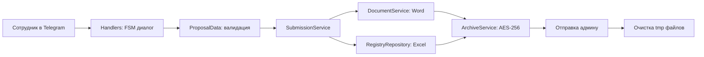

# Telegram-бот для сбора предложений по улучшению процессов (ППУ)

Автоматизированный инструмент для сбора, документирования и зашифрованной передачи предложений сотрудников по оптимизации бизнес-процессов.

## Назначение

Бот позволяет сотрудникам заполнять форму ППУ через Telegram, прикреплять фото «до» и «после», а администратору — автоматически получать зашифрованный архив с Word-документом и обновлённым Excel-реестром.

## Технологический стек

- **Язык программирования**: Python 3.11
- **Фреймворк Telegram Bot**: `aiogram` (v2.x)
- **Генерация документов**: `docxtpl`, `python-docx`
- **Работа с Excel**: `openpyxl`
- **Шифрование архивов**: `pyzipper` (AES-256)
- **Хранение данных**: локальные файлы (Excel, DOCX, изображения)

## Безопасность

- Все конфиденциальные параметры передаются через переменные окружения (`.env.example`).
- Архивы шифруются паролем (AES-256).
- Исходные временные файлы удаляются после успешной отправки.
- Шаблоны документов и реальные данные не включены в репозиторий.


## Архитектура

### Пайплайн обработки ППУ


## Установка и запуск

1. Клонирование репозитория:
   ```bash
   git clone https://github.com/armatveeeva/ppu-telegram-bot.git
   cd ppu-telegram-bot
   pipx install poetry
   poetry install
   cp config/.env.example .env  # Заполните PPU_BOT_TOKEN, PPU_ADMIN_CHAT_ID, PPU_ARCHIVE_PASSWORD
   make run