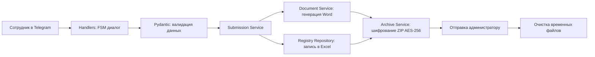

# Telegram-бот для сбора предложений по улучшению процессов (ППУ)

Автоматизированный инструмент для сбора, документирования и зашифрованной передачи предложений сотрудников по оптимизации бизнес-процессов.

## Назначение

Бот позволяет сотрудникам заполнять форму ППУ через Telegram, прикреплять фото «до» и «после», а администратору — автоматически получать зашифрованный архив с Word-документом и обновлённым Excel-реестром.

## Технологический стек

- **Язык программирования**: Python 3.11
- **Фреймворк Telegram Bot**: `aiogram` (v2.x)
- **Генерация документов**: `docxtpl`, `python-docx`
- **Работа с Excel**: `openpyxl`
- **Шифрование архивов**: `pyzipper` (AES-256)
- **Хранение данных**: локальные файлы (Excel, DOCX, изображения)

## Безопасность

- Все конфиденциальные параметры передаются через переменные окружения (`.env.example`).
- Архивы шифруются паролем (AES-256).
- Исходные временные файлы удаляются после успешной отправки.
- Шаблоны документов и реальные данные не включены в репозиторий.

# Автоматизированный Telegram-бот для сбора и обработки предложений по улучшению процессов (ППУ)

Репозиторий содержит программную реализацию автоматизированного инструмента для сбора, документирования и защищенной передачи предложений сотрудников по оптимизации бизнес-процессов (ППУ).

## Описание предметной области

Данное решение реализует сквозной автоматизированный пайплайн:
1. **Структурированный сбор**: сотрудник заполняет форму ППУ через диалоговый интерфейс Telegram (с возможностью прикрепления фотоматериалов «до» и «после»).
2. **Автоматическая генерация отчетности**: система формирует стандартизированный Word-документ на основе шаблона и обновляет сводный Excel-реестр.
3. **Защищенная передача**: итоговые файлы упаковываются в архив с шифрованием AES-256 и передаются администратору, после чего временные файлы безопасно удаляются.

## Технологический стек

- **Язык**: Python 3.11+
- **Фреймворк**: `aiogram` 3.x (асинхронный)
- **Валидация**: `pydantic` v2 + `pydantic-settings`
- **Документы**: `docxtpl`, `python-docx`, `openpyxl`
- **Криптография**: `pyzipper` (AES-256)
- **Инструменты**: Poetry, Ruff, MyPy, Pytest, Docker, GitHub Actions

## Архитектура

### Пайплайн обработки


## Установка и запуск

1. Клонирование репозитория:
   ```bash
   git clone https://github.com/armatveeeva/ppu-telegram-bot.git
   cd ppu-telegram-bot